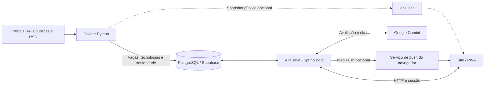

<div align="center">
  
  <br><br>
  
  <h1>Techedin</h1>
  <p><strong>Vagas de tecnologia, inteligência de mercado e orientação de carreira em um só lugar.</strong></p>
  <p>Python · PostgreSQL · Java 21 · Spring Boot · JavaScript · Google Gemini · PWA</p>
</div>

---

## Sobre o projeto

O **Techedin** reúne uma amostra de vagas públicas de tecnologia e transforma suas descrições em informações que ajudam a entender o mercado: tecnologias citadas, empresas contratantes, senioridade e evolução das publicações.

Além do painel público, o usuário pode criar uma conta, anexar seu currículo, receber uma avaliação textual de **0 a 10**, explorar vagas relacionadas às suas habilidades e conversar com um assistente de carreira. O site também pode ser instalado como **Progressive Web App (PWA)**.

A proposta é ajudar em duas perguntas: **“O que as vagas estão pedindo?”** e **“Como posso preparar melhor meu perfil para essas oportunidades?”**

> Os dados representam uma amostra coletada, não todo o mercado de trabalho. O Techedin encaminha o usuário ao anúncio original e não realiza candidaturas automaticamente.

## Navegação

- [Funcionalidades](#funcionalidades)
- [Como funciona](#como-funciona)
- [Tecnologias](#tecnologias)
- [Fontes de vagas](#fontes-de-vagas)
- [Estrutura do repositório](#estrutura-do-repositório)
- [Executar localmente](#executar-localmente)
- [Configuração](#configuração)
- [Banco de dados e migrations](#banco-de-dados-e-migrations)
- [API](#api)
- [Testes e integração contínua](#testes-e-integração-contínua)
- [Publicação](#publicação)
- [Privacidade e limites](#privacidade-e-limites)
- [Documentação complementar](#documentação-complementar)

## Funcionalidades

### Painel público de vagas e tecnologias

- Resumo de vagas, empresas e tecnologias identificadas na amostra.
- Ranking das tecnologias mais citadas, com navegação para as vagas relacionadas.
- Gráfico da evolução das publicações por tecnologia e distribuição de senioridade.
- Busca por cargo, empresa ou tecnologia, com links para os anúncios originais.
- Lista de fontes com três itens inicialmente e opção de expandir.
- Leitura da API e alternativa por snapshot JSON de uma coleta real.

A contagem considera **quantas vagas citam uma tecnologia**, não quantas vezes a palavra aparece no anúncio. Sem data de publicação confiável, as análises usam a data da primeira coleta e preservam essa distinção.

### Conta e perfil profissional

- Cadastro, login e logout com sessão no servidor.
- Nome de boas-vindas e acesso ao currículo após autenticação.
- Preferências de cargo, região, modelo de trabalho e senioridade.
- Exclusão da própria conta mediante senha atual e confirmação explícita.

**Na configuração atual, o envio de e-mails está desativado e não é necessário confirmar o e-mail para entrar.** Há implementação opcional de confirmação e recuperação de senha, mas esses fluxos ficam ocultos enquanto o envio estiver desabilitado.

### Currículo e avaliação com IA

O usuário pode anexar um **PDF com texto selecionável ou DOCX**, revisar a extração, salvar correções, substituir o documento e removê-lo.

- Até **5 MB** por arquivo, **20 páginas** de PDF e **100.000 caracteres** extraídos.
- O arquivo original não é mantido; o banco guarda texto e metadados associados à conta.
- Não há OCR: PDFs digitalizados sem texto selecionável precisam de conversão prévia.
- A avaliação é solicitada pelo botão **Avaliar currículo com IA** e usa o Google Gemini.

A nota soma cinco critérios de **0 a 2 pontos**:

| Critério | O que a avaliação considera |
| --- | --- |
| Clareza | Compreensão do texto e objetividade |
| Organização | Estrutura e apresentação das informações no texto extraído |
| Experiências e projetos | Evidências das atividades e dos resultados descritos |
| Habilidades | Forma de apresentar conhecimentos e competências |
| Formação e desenvolvimento | Formação e informações de desenvolvimento profissional |

A resposta inclui justificativas e sugestões. A nota avalia o **conteúdo textual**, não o design visual do PDF nem a chance de contratação. A avaliação permanece na interface e não é salva como histórico no banco. Sem resposta válida da IA, o sistema não inventa uma nota.

### Assistente de carreira

Um botão com ícone de **raio** abre um chat compacto para dúvidas sobre currículo, candidaturas e entrevistas.

O assistente consulta automaticamente o currículo salvo da conta a cada pergunta: não é necessário anexá-lo novamente no chat. Isso é uso de **contexto**, não treinamento permanente do modelo com o documento. Alterar ou excluir o currículo invalida o uso do contexto anterior.

A conversa fica na memória da página e é descartada ao limpar o chat, recarregar ou sair. As instruções de negócio orientam o modelo a permanecer no escopo de carreira, sem eliminar as limitações de respostas geradas por IA.

### Recomendações de vagas

O sistema compara as tecnologias do currículo com uma amostra de até **2.000 vagas** e retorna até **20 sugestões**, explicando habilidades em comum e outras tecnologias citadas no anúncio.

A ordenação é determinística: considera cobertura de tecnologias, relação com o cargo desejado e senioridade. Ela não depende do Gemini. Localização e modelo de trabalho são preferências armazenadas, mas ainda não entram no ranking por falta de dados uniformes das fontes.

### PWA e notificações

- Instalação no desktop e no celular, conforme o suporte do navegador.
- Ícones próprios para o aplicativo, iOS, Android e favicon.
- Service worker e uma tela de indisponibilidade para uso sem conexão.
- Implementação de Web Push por dispositivo, com permissão solicitada por ação do usuário.
- Alertas baseados no mesmo motor de correspondência entre currículo e vagas.

**O push é opcional e vem desativado por padrão (`WEB_PUSH_ENABLED=false`).** Para funcionar, precisa de configuração VAPID, contexto seguro, permissão do dispositivo, API ativa e coleta contínua. No iOS, siga as instruções de instalação e compatibilidade exibidas pelo app.

Os avisos são genéricos e abrem as sugestões no site; não carregam o texto do currículo. O cache offline não guarda APIs, sessão, currículo ou conversas. A instalação do PWA não transforma o painel em uma base completa disponível offline.

## Como funciona



1. **Coleta:** conectores consultam fontes públicas e extraem título, empresa, descrição, URL e data quando disponível.
2. **Normalização:** o catálogo compartilhado identifica tecnologias e aliases; a senioridade é extraída do título.
3. **Persistência:** o pipeline grava vagas e suas relações analíticas em transação, preservando a identidade por fonte e URL.
4. **Consulta:** a API fornece o painel público e os recursos privados de cada conta.
5. **Interface:** o frontend apresenta os gráficos, oportunidades, currículo, sugestões e assistente.

O coletor e a API são **processos separados**. Clicar em **Atualizar painel** relê os dados disponíveis; não inicia uma nova coleta nos portais.

## Tecnologias

| Camada | Tecnologias | Responsabilidade |
| --- | --- | --- |
| Frontend | HTML5, CSS3, JavaScript com módulos ES | Interface responsiva sem framework de UI |
| Visualização | Chart.js | Gráficos e evolução das tecnologias |
| PWA | Web App Manifest, Service Worker, Push API e Notifications API | Instalação, tela offline e notificações |
| Backend | Java 21, Spring Boot 3.4.5, Spring Web e Bean Validation | API REST e validação de requisições |
| Autenticação | Spring Security, BCrypt, sessões HTTP e CSRF | Controle de acesso e proteção das operações privadas |
| Persistência | Spring Data JPA/Hibernate e JdbcTemplate | Consultas analíticas e operações transacionais |
| Banco | PostgreSQL, com Supabase no ambiente hospedado | Vagas, dados analíticos e dados privados das contas |
| Versionamento SQL | Flyway | Migrations V1–V7 para ambientes gerenciados |
| Extração de currículo | Apache PDFBox e leitura ZIP/XML de DOCX | Conversão do documento em texto |
| Inteligência artificial | Google Gemini API, via cliente HTTP Java | Avaliação do currículo e chat |
| Ingestão | Python, Playwright, psycopg2 e python-dotenv | Coleta, extração e gravação no PostgreSQL |
| E-mail opcional | Spring Mail / SMTP | Confirmação e recuperação, desativadas atualmente |
| Infraestrutura | Docker, Docker Compose, Nginx, Vercel e Render | Execução local e hospedagem |
| Qualidade | JUnit, Spring Boot Test, H2, Testcontainers, unittest, Node Test Runner e Playwright | Testes de API, dados e interface |
| Automação | GitHub Actions e Maven Wrapper | Verificação e empacotamento no CI |

## Fontes de vagas

| Fonte | Canal implementado | Observação |
| --- | --- | --- |
| Gupy | Busca pública e páginas dos anúncios | Depende do HTML e da disponibilidade do portal |
| Catho | Coletor de páginas públicas | Pode responder HTTP 403; bloqueios não são contornados |
| We Work Remotely | RSS de programação | Mantém atribuição e link da fonte |
| Remotive | API pública | Atraso de 24 horas nos anúncios e cache mínimo de 6 horas |
| Nubank | API pública da Ashby | Considera anúncios listados do board da empresa |
| iFood | Job Board API pública do Greenhouse | Board identificado pelo portal de carreiras |
| Itaú | Lista pública e dados estruturados dos anúncios | Amostra limitada, sem paginação completa |
| Sicoob | Portal Sicoob/Empregare | Busca pública de TI e descrição dos anúncios |
| Empregare | Busca de tecnologia e dados estruturados | Considera os limites de validade identificados |
| Santander | Portal público Workday | Filtros de Brasil e famílias técnicas |

**CAIXA, Infojobs e Indeed não têm monitoramento ativo nesta versão.** A CAIXA exige tratamento específico de concursos/editais; o acesso ao Infojobs ainda precisa de validação; o Indeed depende de um canal autorizado.

Há cache, intervalos mínimos, espera após falhas e preservação da última resposta válida. A consulta de uma fonte pode falhar sem interromper as demais. Veja canais, comandos e limites em [Fontes e operação da coleta](docs/JOB_SOURCES.md).

## Estrutura do repositório

```text
Techedin---AnalysisData/
├── backend/                     # API Java / Spring Boot e Maven Wrapper
│   ├── src/main/java/           # Contas, currículo, IA, recomendações e analytics
│   ├── src/main/resources/      # Configuração, catálogo e migrations empacotadas
│   ├── src/test/                # Testes Java e integração
│   └── Dockerfile
├── frontend/                    # Site estático e PWA
│   ├── assets/                  # Logo e símbolo da marca
│   ├── css/                     # Estilos e layout responsivo
│   ├── js/                      # Painel, conta, currículo, chat e PWA
│   ├── icons/                   # Ícones de instalação
│   ├── tests/                   # Testes dos módulos e service worker
│   ├── manifest.webmanifest
│   ├── sw.js
│   └── vercel.json              # Proxy /api para o backend publicado
├── ingestion/
│   ├── scrapers/                # Conectores e persistência das vagas
│   ├── tests/                   # Testes da coleta e do banco
│   ├── technologies.json        # Catálogo canônico e aliases
│   └── .env.example             # Exemplo sem credenciais reais
├── database/
│   ├── migrations/              # SQL canônicos V1–V7
│   └── seeds/                   # Cópia do catálogo inicial
├── tools/                       # Inicialização, configuração e verificações
├── docs/                        # Guias técnicos e operacionais
├── .github/workflows/ci.yml     # Integração contínua
└── docker-compose.yml           # Ambiente local
```

## Executar localmente

### Opção 1 — Ambiente completo com Docker

Requisito: **Docker com Docker Compose**. Na raiz do repositório:

```sh
docker compose up --build -d db backend frontend
```

| Serviço | Endereço local |
| --- | --- |
| Site | http://localhost:8081 |
| API | http://localhost:8080 |
| Estado da sessão | http://localhost:8080/api/auth/session |

O Compose cria um PostgreSQL local. Em um banco novo, o Flyway aplica as migrations automaticamente; não há preenchimento automático com vagas fictícias.

Para coletar uma primeira amostra real:

```sh
docker compose --profile ingestion run --rm scraper --max-jobs 10
```

O Compose padrão não repassa `GEMINI_API_KEY` ao backend. Para usar IA nesse modo, adicione a variável ao ambiente do serviço `backend` em uma sobreposição local, como `docker-compose.override.yml`, sem versionar o segredo.

Os dados ficam em volumes. Para desligar preservando o banco, use `docker compose down`, sem `-v`.

### Opção 2 — API e coletor sem Docker

Requisitos: **Java 21**, **Python 3.12+** e um banco **PostgreSQL** acessível. O Docker local usa PostgreSQL 16; o Supabase é uma alternativa para o banco hospedado. Os comandos abaixo usam PowerShell na raiz do projeto.

**1. Prepare o Python:**

```powershell
python -m venv .venv
.\.venv\Scripts\Activate.ps1
python -m pip install -r ingestion/requirements.txt
python -m playwright install chromium

if (!(Test-Path ingestion/.env)) {
    Copy-Item ingestion/.env.example ingestion/.env
}
```

Edite `ingestion/.env` com `DB_HOST`, `DB_PORT`, `DB_NAME`, `DB_USER`, `DB_PASSWORD` e `DB_SSLMODE` do seu banco. Use `require` para o Supabase e `disable` apenas para um PostgreSQL local sem TLS.

**2. Inicie a API em um terminal:**

```powershell
# Banco novo ou já gerenciado pelo Flyway:
python tools/start_backend.py
```

Se estiver usando um banco com **V1–V7 já aplicadas manualmente**, como o Supabase configurado neste projeto:

```powershell
python tools/check_database.py
python tools/start_backend.py --manual-schema
```

O inicializador carrega o `.env`, monta a URL JDBC e usa o perfil Maven `runtime`. O modo manual verifica a estrutura e desativa Flyway somente nessa execução. Não use esse modo para tentar criar um schema vazio.

**3. Em outro terminal, com o ambiente Python ativado, execute a coleta:**

```powershell
python ingestion/scrapers/job_scraper.py --max-jobs 10
```

**4. Sirva o frontend em outro terminal:**

```powershell
python -m http.server 8081 --directory frontend --bind 127.0.0.1
```

Abra **http://localhost:8081** e mantenha os processos necessários ativos. Abrir `index.html` diretamente não é o fluxo suportado, pois o frontend usa módulos JavaScript.

### Opção 3 — Somente o painel público, sem banco/API

Depois de instalar as dependências Python e o Chromium:

```powershell
python ingestion/scrapers/job_scraper.py --export-json frontend/data/jobs.json --max-jobs 10
python -m http.server 8081 --directory frontend --bind 127.0.0.1
```

O snapshot permite explorar os dados públicos quando a API está indisponível ou sem vagas. **Contas, currículo, chat e recomendações privadas exigem backend e banco.** O arquivo gerado é ignorado pelo Git e não é incluído automaticamente em uma publicação.

### Coleta periódica

```powershell
python ingestion/scrapers/job_scraper.py --watch --interval-seconds 1800 --max-jobs 20
```

O processo precisa permanecer em execução. Cada fonte mantém seu próprio intervalo mínimo; `--watch` não elimina o cache nem promete vagas instantaneamente. O parâmetro `--api-only` executa os canais HTTP públicos sem Chromium/RSS, incluindo os novos portais de empregadores.

## Configuração

Use [ingestion/.env.example](ingestion/.env.example) como referência. O coletor lê `ingestion/.env`; o Spring Boot usa variáveis do processo. **O helper `tools/start_backend.py` faz a ponte entre os dois no desenvolvimento.** Em hospedagem, configure as variáveis no painel privado de cada serviço.

| Variável | Uso |
| --- | --- |
| `DB_HOST`, `DB_PORT`, `DB_NAME`, `DB_USER`, `DB_PASSWORD`, `DB_SSLMODE` | Conexão PostgreSQL do coletor e do inicializador local |
| `DB_URL`, `DB_USER`, `DB_PASSWORD` | Conexão JDBC quando a API é iniciada diretamente ou hospedada |
| `PORT` | Porta da API; 8080 por padrão |
| `GEMINI_API_KEY` | Habilita avaliação e chat no backend |
| `GEMINI_MODEL` | Sobrescreve o modelo padrão; use um modelo compatível e disponível para sua chave |
| `CORS_ALLOWED_ORIGINS` | Lista de origens autorizadas, separadas por vírgula |
| `SESSION_COOKIE_SECURE` | `true` para o ambiente publicado com HTTPS |
| `ACCOUNT_REQUIRE_VERIFICATION` | `false` na configuração atual |
| `ACCOUNT_MAIL_MODE` | `disabled` atualmente; `local` e `smtp` são modos opcionais |
| `APP_PUBLIC_URL` | URL pública do frontend |
| `WEB_PUSH_ENABLED` | Liga o registro e o envio de push; padrão `false` |
| `WEB_PUSH_PUBLIC_KEY`, `WEB_PUSH_PRIVATE_KEY`, `WEB_PUSH_SUBJECT` | Configuração VAPID das notificações |
| `SCRAPER_URLS`, `SCRAPER_RSS_URLS` | Portais e feeds da coleta |
| `SCRAPER_CACHE_DIR` | Diretório do cache operacional |

As variáveis `SCRAPER_REMOTIVE_ENABLED`, `SCRAPER_NUBANK_ENABLED`, `SCRAPER_IFOOD_ENABLED`, `SCRAPER_SANTANDER_ENABLED` e `SCRAPER_EMPLOYER_PAGES_ENABLED` controlam os conectores adicionais. Chaves, senhas e arquivos `.env` nunca devem ir para o frontend ou para o Git.

Sem `GEMINI_API_KEY`, as funcionalidades de IA ficam indisponíveis, mas os recursos que não dependem dela continuam funcionando. Upload do currículo não chama a avaliação automaticamente; o chat usa o texto salvo como contexto quando é consultado.

## Banco de dados e migrations

O banco combina um **modelo estrela para análises** com tabelas privadas para os usuários:

| Grupo | Tabelas |
| --- | --- |
| Dimensões analíticas | `dim_job`, `dim_technology`, `dim_date`, `dim_seniority` |
| Relações para as métricas | `fact_job_technology` |
| Contas e preferências | `app_user`, `app_user_preferences` |
| Currículo | `app_user_resume` |
| Notificações | `app_push_subscription` |
| Tokens opcionais de conta | `app_account_token` |

As migrations ficam em [database/migrations](database/migrations), com cópias em `backend/src/main/resources/db/migration` para empacotamento. A V1 cria o modelo analítico; V2 adiciona o catálogo; V3 trata identidade e procedência das vagas; V4 adiciona contas; V5, currículo; V6, push e descoberta; V7, confirmação e recuperação opcionais.

Em um banco novo, o Flyway aplica V1–V7. Em um banco administrado manualmente, confira o estado antes de aplicar qualquer SQL: **reexecutar uma migration já aplicada não é necessário**. Não use `create-drop`, `repair` ou baseline sobre o banco com dados sem analisar o histórico.

```powershell
python tools/check_migrations.py
python tools/check_database.py
```

O primeiro verifica a sincronização dos SQL e do catálogo. O segundo inspeciona o banco configurado sem alterar registros. O catálogo em `database/seeds` é uma cópia do seed da V2, não uma migration adicional a executar novamente.

## API

O backend expõe JSON sob `/api`. Estes são os principais endpoints:

| Método | Caminho | Função |
| --- | --- | --- |
| `GET` | `/api/dashboard` | Amostra pública de vagas e tecnologias |
| `GET` | `/api/technologies` | Catálogo de tecnologias |
| `GET` | `/api/technologies/trends` | Evolução das menções por data |
| `GET` | `/api/technologies/{name}` | Métricas de uma tecnologia |
| `GET` | `/api/analytics/seniority` | Análise por senioridade |
| `GET` | `/api/auth/session` | Estado da autenticação, inclusive sem login |
| `GET` | `/api/auth/options` | Disponibilidade dos fluxos de conta/e-mail |
| `GET` | `/api/auth/csrf` | Token para operações de escrita |
| `POST` | `/api/auth/register` | Cadastro |
| `POST` | `/api/auth/login` | Login |
| `POST` | `/api/auth/logout` | Logout |
| `GET` | `/api/account` | Perfil autenticado |
| `PUT` | `/api/account/preferences` | Atualização das preferências |
| `DELETE` | `/api/account` | Exclusão da própria conta |
| `GET`, `POST`, `PUT`, `DELETE` | `/api/account/resume` | Consulta, upload, revisão e remoção do currículo |
| `GET`, `POST` | `/api/account/resume/evaluation` | Disponibilidade e solicitação da avaliação |
| `POST` | `/api/account/career-chat` | Pergunta ao assistente |
| `GET` | `/api/account/recommendations` | Sugestões baseadas no currículo |
| `GET`, `POST`, `DELETE` | `/api/account/notifications` | Configuração e inscrição de push |
| `POST` | `/api/account/notifications/status` | Estado da inscrição deste dispositivo |

Os caminhos `/api/account/**` exigem autenticação. Operações de escrita usam cookie da sessão e o cabeçalho CSRF fornecido pela API. O frontend trata esses detalhes automaticamente.

Há endpoints opcionais de confirmação/recuperação em `/api/auth/verification/*` e `/api/auth/password/*`. O disparo administrativo do scraper fica desativado por padrão; na operação normal, use o processo Python separado.

## Testes e integração contínua

Os testes cobrem extração de currículo, validação da IA, autenticação/CSRF, isolamento entre contas, recomendações, push, parsers das fontes, integridade de dados, configuração de publicação e comportamento da interface.

**Java — dentro de `backend/`:**

```powershell
.\mvnw.cmd -Pruntime test
.\mvnw.cmd "-Pruntime,integration" verify
```

Em Linux/macOS, use `./mvnw` no lugar de `.\mvnw.cmd`. Os testes de migrations com Testcontainers precisam de Docker e podem ser pulados quando ele não estiver disponível.

**Python e JavaScript — na raiz:**

```powershell
python -m unittest discover -s ingestion/tests -v
python -m unittest discover -s tools/tests -v
node --test frontend/tests/*.test.mjs
python tools/check_migrations.py
```

Os testes Python que gravam em PostgreSQL exigem `TEST_DB_DSN` apontando para um **banco exclusivo de testes**, nunca para o banco usado pelos usuários. Sem essa variável, os testes correspondentes são pulados.

**Interface e PWA — Playwright com Chromium instalado:**

```powershell
python tools/check_account_frontend.py
python tools/check_pwa.py
```

O teste de conta usa uma API simulada e dados sintéticos. O teste do PWA valida um service worker real, instalação, tela offline e ausência de cache privado.

O [workflow do GitHub Actions](.github/workflows/ci.yml) verifica migrations e catálogo, executa testes de Python/Node/Java, valida o Compose, constrói imagens Docker e gera o JAR como artefato. Ele não faz deploy automático por conta própria.

## Publicação

A organização atual usa **Vercel para o frontend**, **Render para a API Java** e **Supabase para PostgreSQL**. O coletor Python precisa de um processo separado para atualizar as vagas continuamente.

| Componente | Configuração |
| --- | --- |
| Frontend | Projeto estático com raiz em `frontend/` |
| API | Dockerfile em `backend/Dockerfile`, contexto `backend` |
| Comunicação | Rewrite `/api/:path*` em `frontend/vercel.json`, mantendo o navegador na origem do site |
| Banco | Credenciais apenas no backend e no coletor |
| Coletor | Worker/processo com `--watch` e cache persistente |

A rewrite atual aponta para `https://techedin-analysisdata.onrender.com`. Para outra instalação, substitua pela **sua própria API**:

```powershell
python tools/configure_vercel_api.py --api-url https://SUA-API.example.com
```

O frontend não deve receber a senha do banco nem a chave do Gemini. Se o banco hospedado já tem as migrations manuais, mantenha Flyway desativado nesse ambiente; para uma base nova, utilize o fluxo de migrations gerenciado.

Uma API suspensa por inatividade não executa o dispatcher de push durante a suspensão. Publicar o site e a API não instala automaticamente o coletor nem habilita notificações. Sessões são locais ao processo e encerram em reinicializações; múltiplas instâncias exigem armazenamento compartilhado de sessão.

Veja o roteiro completo em [Publicação](docs/DEPLOYMENT.md).

## Privacidade e limites

- **Conta:** senhas protegidas com BCrypt; cookie HttpOnly/SameSite, CSRF e CORS com origens explícitas. HTTPS e cookie Secure são necessários no ambiente público.
- **Isolamento:** os endpoints privados usam a identidade da sessão, não um identificador de usuário fornecido para consultar dados de outra conta.
- **Dados no banco:** tabelas privadas têm RLS e restrições de acesso público na Data API do Supabase. Isso não substitui a autenticação implementada no backend.
- **IA externa:** ao solicitar avaliação ou conversar com o assistente, o texto do currículo/contexto é enviado ao Google Gemini. O chat não é persistido pelo Techedin.
- **Exclusão:** remove conta e dados vinculados no banco da aplicação por cascata; backups e serviços externos seguem suas próprias políticas de retenção.
- **Limites de uso:** há limites de requisições e concorrência por processo. A configuração deve ser revista para operação com proxy e múltiplas instâncias.
- **Qualidade da amostra:** não há cobertura completa, promessa de vaga ativa nem exclusão automática de todos os anúncios encerrados. Confira a origem antes de se candidatar.
- **Correspondência:** tecnologias são identificadas por texto e aliases; uma menção não comprova domínio profissional nem transforma todos os termos em requisitos obrigatórios.
- **Alertas:** dependem da frequência de cada fonte, permissões e entrega pelo provedor; não há garantia de aviso imediato ou de ser o primeiro candidato.
- **Falhas:** não há substituição silenciosa de dados reais por vagas ou notas fictícias. Dados demo podem ser gerados separadamente para desenvolvimento e são rejeitados pelo fluxo principal.

## Documentação complementar

| Documento | Conteúdo |
| --- | --- |
| [Publicação](docs/DEPLOYMENT.md) | API Docker, variáveis, Vercel, proxy e coletor |
| [Fontes de vagas](docs/JOB_SOURCES.md) | Conectores, intervalos, cache e limitações das fontes |
| [PWA e Web Push](docs/PWA_PUSH.md) | VAPID, inscrição por dispositivo e testes em celular |
| [Contas e e-mail opcional](docs/ACCOUNTS_PRODUCTION.md) | Confirmação, recuperação, exclusão e SMTP opcional |
| [Histórico da implementação](docs/IMPLEMENTATION_STATUS.md) | Evolução técnica e verificações por etapa |

Alguns documentos operacionais registram etapas anteriores do desenvolvimento. O comportamento atual de e-mail é **envio desativado e login sem confirmação**; a configuração de cada ambiente determina se o push e a coleta periódica estão ativos.
